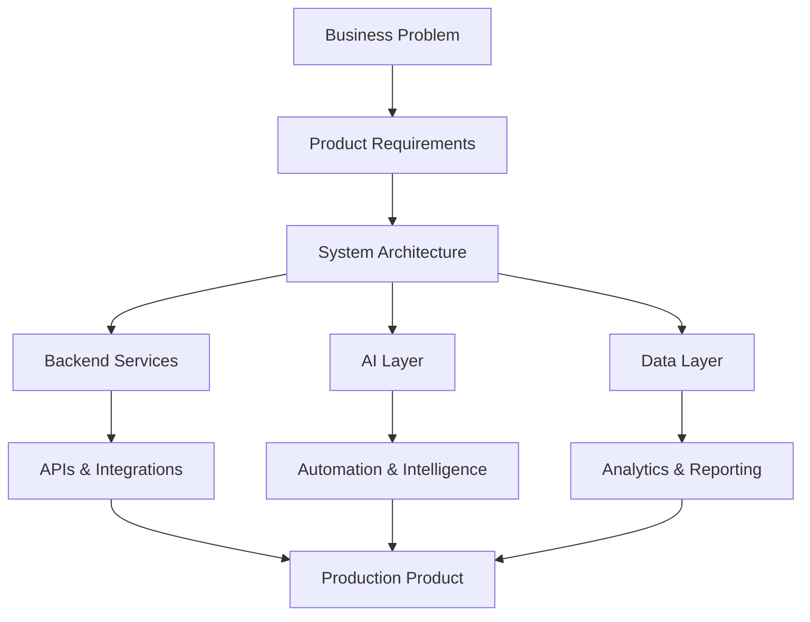

<div align="center">


<br />


<br />
<br />

<a href="mailto:gilfoyle.arthur@protonmail.com">
  
</a>
<a href="https://twitter.com/ni_athur" target="_blank">
  
</a>


</div>

---

<div align="center">

## Principal Software Engineer building intelligent, reliable, production-grade systems.

I work across **backend engineering, AI systems, platform architecture, fintech products, APIs, automation, enterprise workflows, and full-stack product development**.

</div>

---

## Engineering Identity

<table>
<tr>
<td width="50%">

### What I Build

I design and build systems that are:

* Scalable
* Secure
* Maintainable
* API-driven
* Observable
* Business-focused
* Production-ready

</td>
<td width="50%">

### Where I Focus

* Backend systems
* AI-powered applications
* Fintech platforms
* Enterprise software
* Multi-tenant systems
* Automation workflows
* Developer-friendly platforms

</td>
</tr>
</table>

---

## Engineering Dashboard

<div align="center">


<br />
<br />


<br />
<br />


<br />
<br />


</div>

---

## Contribution Graph

<div align="center">


</div>

---

## Technology Stack

<div align="center">

### Languages


<br />
<br />

### Frontend


<br />
<br />

### Backend, Databases & Infrastructure


<br />
<br />

### AI, Cloud & Product Engineering


</div>

---

## Principal Engineering Scope

<table>
<tr>
<td align="center" width="25%">

<br />
<br />
Architecture, boundaries, scale, reliability, maintainability.
</td>
<td align="center" width="25%">

<br />
<br />
APIs, services, databases, integrations, workflows.
</td>
<td align="center" width="25%">

<br />
<br />
LLM apps, RAG, assistants, automation, document intelligence.
</td>
<td align="center" width="25%">

<br />
<br />
Clean interfaces, business workflows, dashboards, delivery.
</td>
</tr>
</table>

---

## System Architecture Mindset



---

## What I Care About

<table>
<tr>
<td width="33%">

### Reliability

Systems should behave predictably under real-world usage.

</td>
<td width="33%">

### Maintainability

Good software should be easy to understand, extend, and improve.

</td>
<td width="33%">

### Business Impact

Engineering should solve practical problems and create measurable value.

</td>
</tr>
<tr>
<td width="33%">

### Security

User data, access control, and system trust must be designed from the start.

</td>
<td width="33%">

### Performance

Fast systems improve user experience and reduce operational cost.

</td>
<td width="33%">

### Clarity

The best systems are simple enough to reason about and strong enough to scale.

</td>
</tr>
</table>

---

## Areas I Build In

<div align="center">


</div>

---

## GitHub Trophy Board

<div align="center">


</div>

---

## Engineering Principles

```txt
Design for clarity.
Build for reliability.
Secure by default.
Automate repetitive work.
Keep systems observable.
Make APIs predictable.
Optimize for maintainability.
Ship products that solve real problems.
```

---

## Current Direction

I am currently focused on building **AI-enabled software products, fintech systems, backend platforms, enterprise applications, and intelligent automation tools** that can move from prototype to production.

<div align="center">

<br />


<br />
<br />

<a href="mailto:gilfoyle.arthur@protonmail.com">
  
</a>

<br />
<br />


</div>
