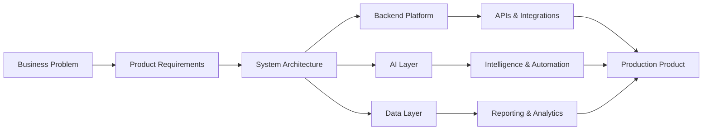

 
 

 

<table>
<tr>
<td align="center" width="25%">

 
Architecture, systems, delivery
</td>
<td align="center" width="25%">

 
Intelligent software products
</td>
<td align="center" width="25%">

 
Building for local and global markets
</td>
<td align="center" width="25%">

 
Products, platforms, consulting
</td>
</tr>
</table>

---

 

## Executive Summary

I am a **software engineer and AI engineer** focused on building **reliable backend systems, intelligent applications, fintech platforms, enterprise workflows, APIs, dashboards, and production-ready digital products**.

My work combines **software architecture, backend engineering, AI systems, database design, automation, product thinking, and technical leadership**. I care about systems that are clean, secure, scalable, maintainable, observable, and useful to real businesses.

 

---

 

## Engineering Portfolio

<table>
<tr>
<td width="50%">

### Platform Engineering

Designing backend platforms, APIs, service boundaries, authentication flows, database models, integrations, and operational systems that can support real business scale.

</td>
<td width="50%">

### AI Engineering

Building AI-enabled products, intelligent assistants, document intelligence workflows, RAG systems, automation tools, and AI-powered business applications.

</td>
</tr>
<tr>
<td width="50%">

### Product Architecture

Translating complex business workflows into clean software systems with strong usability, maintainable architecture, and production-focused delivery.

</td>
<td width="50%">

### Fintech Systems

Working around financial workflows, core banking concepts, reporting, dashboards, transaction systems, multi-tenant products, and operational automation.

</td>
</tr>
</table>

---

 

## Technical Operating Model

---

 

## GitHub Intelligence

 
 

 
 

---

 

## Contribution Graph

---

 

## Technology Landscape

<table>
<tr>
<td align="center" width="25%">
<h3>Languages</h3>

</td>
<td align="center" width="25%">
<h3>Frontend</h3>

</td>
<td align="center" width="25%">
<h3>Backend</h3>

</td>
<td align="center" width="25%">
<h3>Infrastructure</h3>

</td>
</tr>
<tr>
<td align="center" width="25%">
<h3>Databases</h3>

</td>
<td align="center" width="25%">
<h3>AI</h3>

</td>
<td align="center" width="25%">
<h3>Cloud</h3>

</td>
<td align="center" width="25%">
<h3>Tooling</h3>

</td>
</tr>
</table>

---

 

## Principal-Level Engineering Strengths

<table>
<tr>
<td align="center" width="33%">

 
 
Designing clean boundaries, scalable structures, and maintainable technical foundations.
</td>
<td align="center" width="33%">

 
 
Building APIs, services, data flows, authentication, integrations, and workflow engines.
</td>
<td align="center" width="33%">

 
 
Creating intelligent assistants, automation systems, document intelligence, and RAG workflows.
</td>
</tr>
<tr>
<td align="center" width="33%">

 
 
Turning real operational needs into usable, practical, high-value software products.
</td>
<td align="center" width="33%">

 
 
Designing relational structures, reporting models, analytics views, and optimized queries.
</td>
<td align="center" width="33%">

 
 
Guiding projects from requirements to architecture, implementation, deployment, and iteration.
</td>
</tr>
</table>

---

 

## Systems I Like Building

---

 

## Engineering Philosophy

<table>
<tr>
<td align="center" width="20%">
<strong>Clarity</strong>
 
Systems should be easy to reason about.
</td>
<td align="center" width="20%">
<strong>Reliability</strong>
 
Production behavior should be predictable.
</td>
<td align="center" width="20%">
<strong>Security</strong>
 
Trust must be designed from the start.
</td>
<td align="center" width="20%">
<strong>Maintainability</strong>
 
Code should survive growth and change.
</td>
<td align="center" width="20%">
<strong>Impact</strong>
 
Engineering must create business value.
</td>
</tr>
</table>

---

 

## Achievement Board

---

 

## Current Direction

I am currently focused on building **AI-enabled products, fintech systems, backend platforms, enterprise applications, intelligent automation, and software systems that can move from prototype to production**.

 

 
 

 
 

