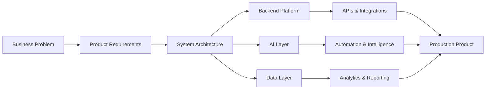
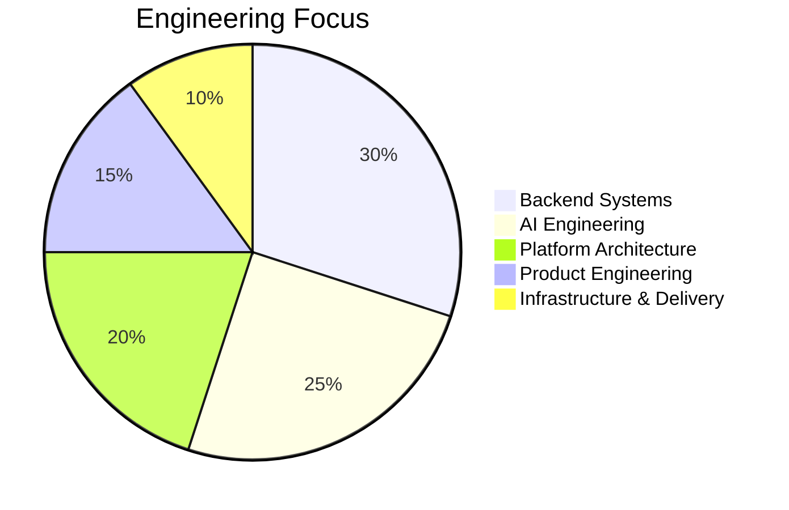

 

 
 

 

## A Software Engineer building intelligent, reliable, production-grade systems.

I work across **backend engineering, AI systems, platform architecture, fintech products, APIs, automation, enterprise workflows, and full-stack product development**.

---

## Executive Profile

<table>
<tr>
<td width="50%">

### Engineering Focus

I design and build software systems that are practical, scalable, secure, maintainable, and ready for real business use.

My work combines **architecture, backend engineering, AI systems, automation, database design, product thinking, and delivery leadership**.

</td>
<td width="50%">

### Core Areas

* Backend systems
* AI-powered applications
* Platform architecture
* Fintech workflows
* Enterprise software
* Multi-tenant systems
* APIs and integrations
* Dashboards and reporting

</td>
</tr>
</table>

---

## Engineering Snapshot

<table>
<tr>
<td align="center" width="25%">
<h3>Architecture</h3>

System design, boundaries, scalability, maintainability.

</td>
<td align="center" width="25%">
<h3>Backend</h3>

APIs, services, databases, authentication, integrations.

</td>
<td align="center" width="25%">
<h3>AI Systems</h3>

LLM apps, RAG, assistants, automation, intelligence layers.

</td>
<td align="center" width="25%">
<h3>Product</h3>

Business workflows, dashboards, usability, delivery.

</td>
</tr>
</table>

---

## GitHub Analytics

 
 

---

## Technology Landscape

### Languages

 
 

### Frontend

 
 

### Backend & APIs

 
 

### Databases & Infrastructure

 
 

### Tools & Cloud

---

## Technical Operating Model

---

## Engineering Distribution

---

## Principal-Level Strengths

<table>
<tr>
<td width="33%">

### System Architecture

Designing clear technical foundations, service boundaries, data flows, integration patterns, and scalable product structures.

</td>
<td width="33%">

### Backend Engineering

Building APIs, services, authentication, authorization, databases, reporting engines, and workflow automation.

</td>
<td width="33%">

### AI Engineering

Creating AI-powered assistants, document intelligence systems, RAG workflows, automation layers, and business copilots.

</td>
</tr>
<tr>
<td width="33%">

### Product Thinking

Turning complex operational needs into practical software that users can understand, trust, and depend on.

</td>
<td width="33%">

### Database Design

Designing relational models, analytics structures, reporting views, transaction workflows, and optimized queries.

</td>
<td width="33%">

### Delivery Leadership

Moving products from requirements to architecture, implementation, deployment, iteration, and production improvement.

</td>
</tr>
</table>

---

## Systems I Like Building

---

## Engineering Philosophy

<table>
<tr>
<td align="center" width="20%">
<strong>Clarity</strong>
 
Systems should be easy to reason about.
</td>
<td align="center" width="20%">
<strong>Reliability</strong>
 
Production behavior should be predictable.
</td>
<td align="center" width="20%">
<strong>Security</strong>
 
Trust must be designed from the start.
</td>
<td align="center" width="20%">
<strong>Maintainability</strong>
 
Code should survive growth and change.
</td>
<td align="center" width="20%">
<strong>Impact</strong>
 
Engineering must create business value.
</td>
</tr>
</table>

---

## Current Direction

I am currently focused on building **AI-enabled products, fintech systems, backend platforms, enterprise applications, intelligent automation, and software systems that can move from prototype to production**.

 

 
 

 
 

